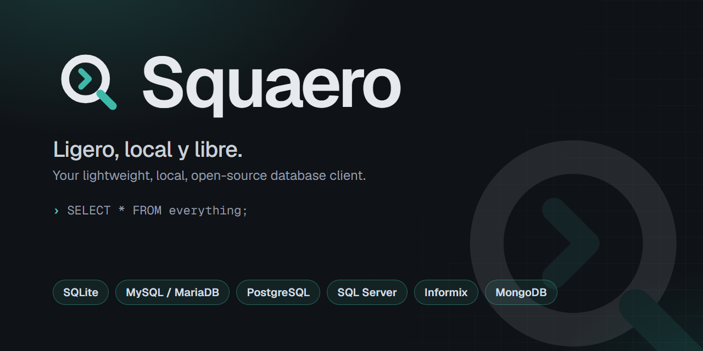
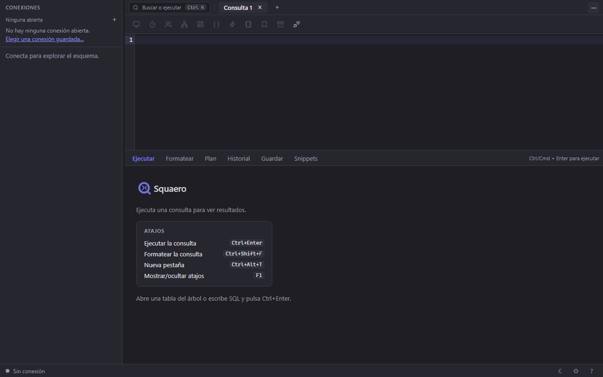

<p align="center">
  
</p>

<p align="center">
  <em>A modern, lightweight, multi-engine database client — an open-source alternative in the spirit of Navicat.</em>
</p>

<p align="center">
  <b>English</b> · <a href="README.es.md">Español</a>
</p>

<p align="center">
  <a href="https://github.com/danielnuld/squaero/releases"></a>
  <a href="LICENSE"></a>
  
</p>

**Squaero** (Latin *quaero*, "I seek / I inquire") is a multi-engine database
client with a **C core** (`libdbcore`) and a **web UI running on the OS-native
webview** (WebView2 on Windows, WebKitGTK on Linux, WKWebView on macOS). A modern
UI without the weight of Electron, and a native engine that talks directly to
each database's client libraries.

## Supported engines

| Engine | Status |
|---|---|
| **SQLite** | ✅ Complete (verified) |
| **PostgreSQL** | ✅ Via libpq — SSL/TLS, SCRAM |
| **MySQL / MariaDB** | ✅ Complete (verified) — SSL/TLS, SSH tunnel |
| **Informix** | ✅ Over DRDA, no IBM client needed |
| **MongoDB** | ✅ mongosh syntax — find/aggregate, writes (insert/update/replace/delete), indexes, `runCommand`; edit documents in the grid by `_id`; a collection's definition as a script; execution plan (`.explain()`), operations monitor (`currentOp`/`killOp`), profiler-backed slow queries, collection/view/index management from the tree, cancel (`killOp`), and transactions on a replica set or sharded cluster (a standalone server says so) |
| **SQL Server** | ✅ Via FreeTDS — queries, types, schema, transactions, encryption, named instances, cancel. Not yet: editing rows in the grid, DDL |
| Oracle | ⏳ Planned (M12) |

Engines load as **plugins** (`.dll`/`.so`) implementing a C contract: adding an
engine never touches the core. See [how to write a driver](docs/WRITING_A_DRIVER.md).

## Features

**SQL editor**
- CodeMirror editor that understands the query: **contextual completion**
  (aliases, CTEs, subqueries, joins along foreign keys, clause keywords),
  **diagnostics** (unknown names, ambiguous columns, risky writes), **go to
  definition**, **find usages** and **rename** within the script, **multicursor**
  and abbreviation **templates**.
- SQL **formatting** per engine dialect; run **selection / statement / document**.
- Query **history** with per-query duration and slow-query marks, and a **local
  history** of each tab's text, so overwritten or closed work can be restored.
- **Snippets / favorites**; **command palette** (Ctrl/Cmd+K).
- **Visual execution plan** (EXPLAIN) as a tree.

**Safe execution**
- Per-connection **safe mode**: read-only (writes are refused before they are
  sent) or confirm writes.
- **Manual transactions** with commit/rollback, or auto-commit.
- **Cancel** a running query on every engine; what an engine cannot do is shown
  disabled with the reason, never faked.
- **Lost-connection recovery** (reconnects, and retries a read only when it is
  safe) and an optional **keep-alive**.

**Result grid**
- Virtualized, per-column **sort and filter**, real **pagination** (offset).
- Inline **transactional editing** (insert/update/delete + SQL preview +
  commit/rollback); **row detail** (form view).
- **Cell-range selection** with a **summary** in the status bar (count, NULLs,
  sum, average, min, max), and a **transposed view** of wide results.
- **Pin** a result so the next run does not replace it, and **compare** two
  results.
- **Export** CSV / JSON / SQL / XML / HTML / **XLSX**; **import** CSV / JSON / XLSX.
- **Charts** (bar / line / pie).

**Objects and design**
- Lazy, virtualized object tree **grouped by type** (tables, views, procedures,
  functions, triggers, events), served from a **schema cache** while it is
  re-read in the background.
- **Table designer** (create and ALTER), **index and constraint editor**.
- **Procedures / functions**, **triggers / events**, **users and privileges**.
- **Server monitor** (process list + kill), **slow queries**.
- **ER diagram** (real foreign keys from the engine) and a **visual query builder**.
- **Search a text** across the tables of a schema.

**Data across connections**
- **Schema diff** with a reviewable, dependency-ordered **migration script**;
  data **sync**, table **transfer** between connections, and test **data
  generation**.
- **Backup and restore**, and the **schema DDL to a folder**, one `.sql` file per
  object, ready to version in git.

**Connectivity and platform**
- **SSH tunnel** (all engines), **SSL/TLS** (MySQL, PostgreSQL, MongoDB, Informix, SQL Server), and
  **import/export** of saved connections — including **DBeaver**'s
  `data-sources.json` (with the `credentials-config.json` beside it) and
  **Navicat**'s `.ncx`, **passwords and all**, so moving in does not start with
  retyping thirty servers.
- Four built-in **styles** — **B · Nativo** (the default), **A · Quiet pro**,
  **C · Editorial** and **Rosa pastel**, each light and dark — plus the earlier
  themes and your own, imported as a file. Configurable typography, interface
  zoom and grid style.
- Desktop behaviour: a **native menu bar** on Windows and Linux, the app's own
  icon set, remembered window state, **editable keyboard shortcuts**
  ([list](docs/SHORTCUTS.md)), adaptive context menus.
- **Single executable** (embedded UI) + drivers as plugins. No Electron.

**Beyond the desktop**
- **`quaero-mcp`**: a [Model Context Protocol](docs/MCP.md) server that exposes
  the connections you opt in to MCP clients, read-only unless you allow writes.
- **iPhone**: the same core and drivers with a SwiftUI app — browse, query,
  edit with Face ID and a transaction, export — and, on devices with Apple's
  on-device model, filter a table by asking. Being prepared for the App Store.

<p align="center">
  
</p>

## Install

**Windows:** download the latest `.msi` installer from
[**Releases**](https://github.com/danielnuld/squaero/releases) and run it. Requires
the **WebView2** runtime (already bundled in Windows 11). Every release attaches a
`SHA256SUMS.txt` to verify the download:
`sha256sum -c SHA256SUMS.txt` (or `CertUtil -hashfile squaero-*.msi SHA256`).
Releases from v0.26.0 on also carry a signed build-provenance attestation, which
proves the MSI was built by this repository's release workflow:
`gh attestation verify squaero-X.Y.Z-x64.msi --repo danielnuld/squaero`.
The MSI is not Authenticode-signed yet, so Windows SmartScreen shows an unknown
publisher.

**Informix** needs no IBM client: Squaero speaks DRDA to the server with
[libdrda](https://github.com/danielnuld/libdrda). The server must have a DRDA
listener (an `sqlhosts` entry of protocol `drsoctcp`, usually port 9089; check
with `onstat -g ntt`). Saved connections from earlier versions move to port
9089 on their own, and ask you to check the port when theirs was not 9088.

**Linux:** from v0.29.0, releases attach a `.deb` for Ubuntu 24.04+ and Debian 13+
(x86_64), listed in the same `SHA256SUMS.txt`:
`sudo apt install ./squaero_X.Y.Z_amd64.deb`. apt pulls in every driver's client
library. On any distribution
with snapd, install it from the [Snap Store](https://snapcraft.io/squaero):
`sudo snap install squaero`.

**macOS:** from v0.32.0, releases attach `squaero-X.Y.Z-arm64.dmg` for Apple
Silicon on macOS 15 or later: open it and drag Squaero to Applications. It is
signed ad hoc, not with an Apple Developer ID, so the first launch is blocked
once: open **System Settings → Privacy & Security** and choose **Open Anyway**
(or run `xattr -dr com.apple.quarantine /Applications/Squaero.app`).

> AppImage/Flatpak and an Intel Mac build are not planned yet.

## Build from source

Requirements: **CMake ≥ 3.20**, a C11 compiler (GCC/Clang/MSVC) and, recommended,
**Ninja**; **Node + pnpm** for the UI.

```bash
# UI (produces frontend/dist/index.html, a single file that gets embedded)
pnpm --dir frontend install
pnpm --dir frontend build

# Core + app
cmake -S . -B build -G Ninja
cmake --build build
ctest --test-dir build --output-on-failure   # core tests
```

The binary lands in `build/app/squaero` (`.exe` on Windows). **Webview
dependencies**: Linux `libgtk-4-dev libwebkitgtk-6.0-dev`; macOS system WebKit;
Windows WebView2 (downloaded at build time). Core only: `-DQUAERO_BUILD_APP=OFF`.

**PostgreSQL:** the driver links `libpq`: a system libpq when there is one; the
Windows release build compiles a static libpq from source with `-DQUAERO_LIBPQ=ON`.

**MongoDB:** the driver links `libmongoc`. Without a system copy, build it from
source with `-DQUAERO_MONGOC=ON` (fetches and statically links mongo-c-driver;
TLS via Secure Channel on Windows).

**SQL Server:** the driver links FreeTDS's db-lib, 1.4 or newer. Without one
(Ubuntu 24.04's is older), `-DQUAERO_FREETDS=ON` fetches FreeTDS and links it
statically, as the release builds do.

**Windows MSI installer:** see [`installer/build-msi.sh`](installer/build-msi.sh)
(WiX v5 via `dotnet tool`). Releases are cut automatically on a version tag — see
[docs/VERSIONING.md](docs/VERSIONING.md).

**Per-engine smoke:** `scripts/smoke/run.sh <sqlite|mysql|mongodb>` — see
[docs/QA-SMOKE.md](docs/QA-SMOKE.md).

## Architecture

```
Frontend (OS webview)  ──JSON IPC──>  C core (libdbcore)  ──vtable──>  Drivers (plugins)
   SolidJS UI, virtual grid,           connection, queries,             sqlite, postgres,
   SQL editor, tools                   introspection, editing, tx       mysql, informix, mongodb, mssql
```

Details in [`docs/ARCHITECTURE.md`](docs/ARCHITECTURE.md).

## Documentation

Most documents under `docs/` are in Spanish; the MCP server, the MongoDB result
model, the UI glossary and the trademark policy are in English.

- [ROADMAP](ROADMAP.md) · [Architecture](docs/ARCHITECTURE.md) · [IPC protocol](docs/IPC.md)
- [Driver contract](docs/DRIVER_API.md) · [How to write a driver](docs/WRITING_A_DRIVER.md) · [MongoDB result model](docs/MONGODB.md)
- [Keyboard shortcuts](docs/SHORTCUTS.md) · [UI glossary](docs/GLOSSARY.md) · [MCP server](docs/MCP.md)
- [Verification matrix](docs/QA-MATRIX.md) · [Per-engine smoke](docs/QA-SMOKE.md) · [Versioning and releases](docs/VERSIONING.md)
- [M14 design direction](docs/design/m14/README.md) · [Brand](assets/brand/BRAND.md) · [Website](docs/SITE.md)
- [Contributing](CONTRIBUTING.md) · [Code of conduct](CODE_OF_CONDUCT.md) · [Third-party inventory](THIRD-PARTY.md) · [Trademark policy](TRADEMARKS.md)

## License

[GPLv3](LICENSE), with an [additional permission](LICENSE-EXCEPTION) to ship
through app stores such as Apple's App Store. The name and logos are covered by
the [trademark policy](TRADEMARKS.md): forks are welcome under their own name.
Proprietary-engine drivers ship as separate plugins, loaded at runtime, to
respect their licenses. Full third-party inventory in
[THIRD-PARTY.md](THIRD-PARTY.md).
